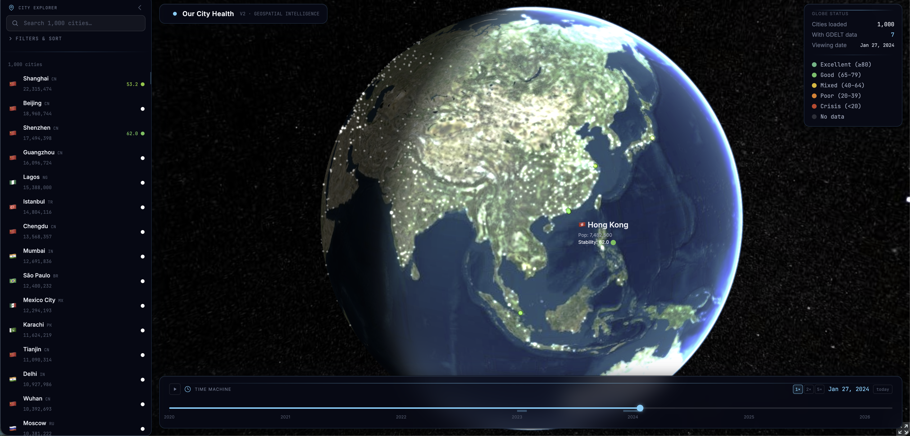
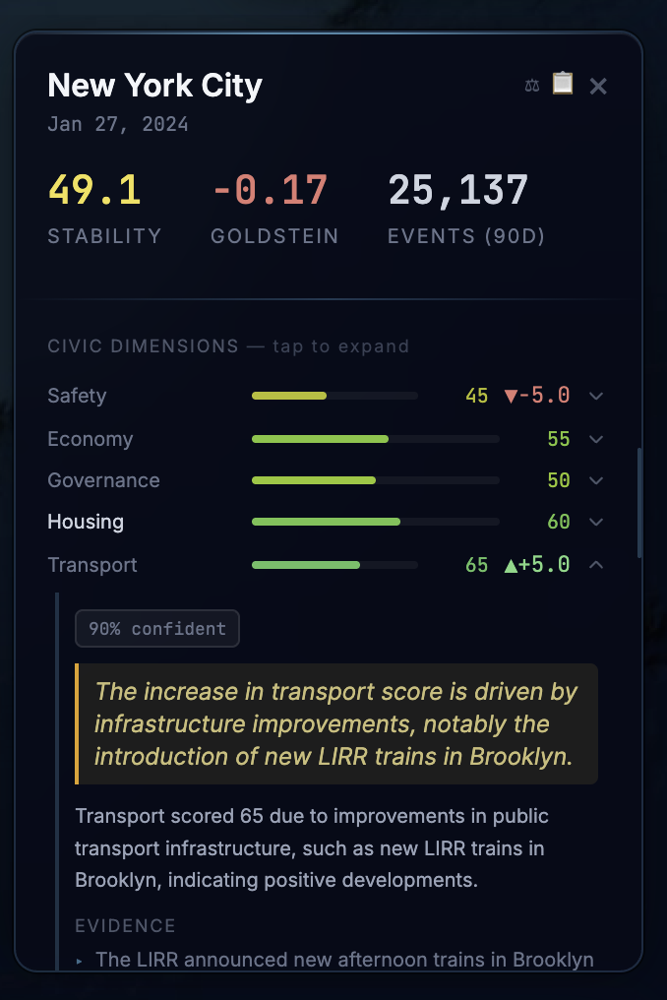

# OurCityHealth

OurCityHealth is a free civic dashboard that shows how cities are doing on things like housing, safety and cost of living, and what is driving the changes. Each city gets a 0 to 100 score on 12 dimensions, a week-over-week change, a short explanation of what caused the change, and links to the news articles behind it.

**Live demo:** [caydenauyang.github.io/OurCityHealth](https://caydenauyang.github.io/OurCityHealth/)

The demo runs on a saved snapshot of scores (news dates from January 2014 to January 2024), so it works without the backend running.



---

## What is OurCityHealth?

OurCityHealth is an API where you call a city name and get back structured JSON with scores across 12 civic dimensions: safety, economy, transport, governance, housing, environment, health, culture, education, technology, community, and cost of living.

Scores update weekly based on a rolling window of global news data. Each score includes a week-over-week delta showing direction of change, a causal explanation of what drove the change, and links to the original source articles. Historical scores are stored for trend tracking over months.

Data comes from AI analysis of 380,000+ news outlets via GDELT, with every source ranked across a 4-tier credibility system (Tier 1: major international wire services, down to Tier 4: unverified sources).

### The Problem

There is no standard, easy way to see how a city is doing and why it is changing:

- **Consultancy reports** (McKinsey, EIU) are deep but cost six figures, cover a few hundred cities, and publish once a year as PDFs.
- **Raw event data** (GDELT) is free but requires building an entire processing pipeline from scratch.
- **Sentiment tools** (Brandwatch, Meltwater) track brand mentions, not places. Their architecture is entity-centric, not geo-centric.
- **Civic platforms** (ZenCity) serve individual city governments, not cross-city comparison or developer integration.

We have not found an actively maintained city intelligence API that is simultaneously continuously updated, multi-dimensional, geo-centric, source-verified with causal attribution, and delivered as structured JSON.

### How It Works

```
380,000+ news sources (GDELT)
        │
        ▼
   INGEST: BigQuery extraction, geospatial filtering (haversine distance)
        │
        ▼
   PROCESS: Event deduplication (25K raw events → 24 real stories),
            4-tier source credibility ranking,
            named entity and theme extraction (GKG)
        │
        ▼
   SCORE: AI evaluation engine produces structured 12-dimension assessments
          with causal attribution and source citations
        │
        ▼
   SERVE: Pre-computed scores via REST API, sub-50ms response times
```

### Example API Response

```json
GET /api/v2/score/{city_id}

{
  "city": "Hong Kong",
  "overall_score": 54,
  "dimensions": {
    "safety": {
      "score": 45,
      "delta": -5.0,
      "causal_driver": "11 police-involved incidents over 4 days, corroborated by 3 Tier-2 sources",
      "confidence": 0.78
    },
    "economy": {
      "score": 60,
      "delta": +3.0,
      "causal_driver": "Trade expo coverage and positive investment sentiment from 5 Tier-1 sources",
      "confidence": 0.85
    }
  },
  "total_articles_analyzed": 39,
  "unique_sources_analyzed": 26,
  "source_tier_breakdown": { "tier_1": 3, "tier_2": 8, "tier_3": 3, "tier_4": 12 }
}
```

---

## What's Built

OurCityHealth has gone through two major versions. V1 was a proof of concept. V2 is the current production system.

### V2 (Current, 2025-2026)

The V2 system is a ground-up rebuild focused on data integrity.

**Backend:**
- Python/FastAPI with async SQLAlchemy
- PostgreSQL with PostGIS for geospatial queries and TimescaleDB for time-series data
- GDELT BigQuery ingestion pipeline covering 380,000+ global news sources
- GKG (Global Knowledge Graph) article-level intelligence extraction: named entities, themes, tone, multi-language processing
- Custom event deduplication engine grouping events by CAMEO code, shared actors, and temporal proximity
- 4-tier source credibility ranking system
- AI evaluation engine with schema-enforced structured outputs (Pydantic V2 + Instructor)
- Pre-computed scoring pipeline serving responses in under 50ms from PostgreSQL
- Redis caching layer

**Frontend:**
- React/TypeScript with CesiumJS 3D globe rendering 1,000+ cities
- Glassmorphism HUD interface with city detail panels, score deltas with causal drivers, source tier badges on all citations
- Timeline scrubber with playback controls and interactive calendar
- City comparison mode with radar charts
- Sidebar explorer with search, filters, and sorting

**Cities scored:** Hong Kong, Shanghai, Shenzhen, Singapore, Tokyo, London, New York (with infrastructure ready for 1,000+)

**API Endpoints:**
```
GET /api/v2/cities                              List all cities with coordinates
GET /api/v2/cities/scores?date=&window_days=    Globe color data (all cities)
GET /api/v2/score/{city_id}?date=               Full intelligence score for a city
GET /api/v2/score/{city_id}/history             Historical time series
GET /api/v2/sources/{city_id}?start=&end=       Source breakdown by credibility tier
GET /api/v2/events/{city_id}                    Raw GDELT events
GET /api/v2/data-coverage                       Dates with available data
```

### V1 (Archived, 2025)

The first version proved the core technical thesis. It used direct web scraping of news sources and Reddit, a Three.js 3D globe, and generative LLM scoring. V1 code is preserved in the `archive/v1/` directory for reference.

---

## The 12-Dimension Taxonomy

| Dimension | What It Captures |
|-----------|-----------------|
| Safety | Crime patterns, policing, public order |
| Housing | Affordability, availability, quality |
| Economy | Job market, business confidence, growth signals |
| Governance | Government trust, corruption, policy effectiveness |
| Transport | Public transit quality, infrastructure investment |
| Environment | Air quality, green space, sustainability |
| Health | Healthcare access, public health conditions |
| Culture | Arts, entertainment, social vibrancy |
| Education | School quality, access, opportunity |
| Technology | Digital infrastructure, tech adoption |
| Community | Social cohesion, civic engagement, trust |
| Cost of Living | Broad affordability, price stress |

Each dimension produces a 0-100 score with a confidence level, week-over-week delta, causal driver explanation, evidence snippets, and source citations with credibility tier badges.



---

## Tech Stack

| Layer | Technology |
|-------|-----------|
| Backend | Python, FastAPI, async SQLAlchemy |
| Database | PostgreSQL + PostGIS + TimescaleDB |
| Data Source | GDELT via Google BigQuery (380,000+ outlets) |
| AI Scoring | Frontier LLM with Instructor/Pydantic schema enforcement |
| Caching | Redis |
| Frontend | React, TypeScript, CesiumJS |
| Deployment | Railway (backend), GitHub Pages (frontend) |
| CI/CD | GitHub Actions |

---

## Repository Structure

```
├── v2_engine/                 Current production system
│   ├── backend_v2/            FastAPI backend, scoring engine, data pipeline
│   ├── frontend_v2/           React/CesiumJS globe interface
│   ├── scripts/               Ingestion and utility scripts
│   ├── Dockerfile             Railway deployment
│   └── requirements.txt
├── archive/                   V1 code (preserved for reference)
├── docs/                      Documentation and images
├── screenshots/               Product screenshots and demo videos
├── .github/workflows/         CI/CD configuration
└── README.md
```

---

## How I built this

I made the core design decisions myself. I chose the 12 civic dimensions each city is scored on and the 4-tier system that ranks how credible each news source is, after researching which ones fit best. I also decided the AI scoring step had to answer in a fixed, structured format, so its output stays consistent from one run to the next and every claim can be traced back to its sources.

I built the code with AI coding tools in Cursor. My job was deciding what to build, testing what came back and fixing what was broken.

---

## Credits

Built by Cayden Auyang, a senior at Pomfret School. See [How I built this](#how-i-built-this).

Thanks to Alvin Mok for feedback.

---

## Sustainability

The public dashboard is free, and a paid API for companies could help fund it later.

---

## Contact

caydenauyang@gmail.com

---

## License

[MIT](LICENSE)
